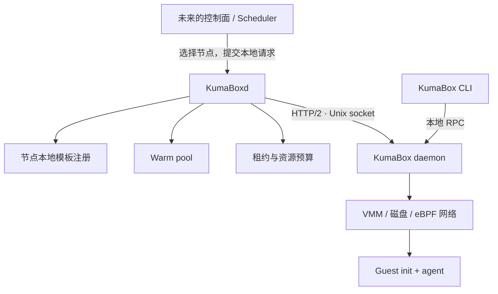

<p align="center">
  
</p>

<h1 align="center">KumaBoxd</h1>
<p align="center">A node agent for KumaBox sandboxes.</p>

KumaBoxd 是构建在 [KumaBox](https://github.com/kgpp34/KumaBox) runtime 之上的节点服务，用于管理本机的沙箱模板、预热池、租约和容量。未来的控制面负责选择节点，KumaBoxd 负责在选中的节点上交付沙箱。

**当前处于早期开发阶段。** 已实现服务入口、健康检查、优雅退出、typed runtime client，以及节点本地模板的注册、查询和持久化。已支持固定库存 warm pool、原子领取、租约续期、TTL/归还销毁、后台补池及重启恢复。当前 API 仅监听 loopback，远程认证、分布式调度和预测控制尚未实现。

## 职责与架构



| 层 | 负责什么 |
| --- | --- |
| KumaBox runtime | 镜像、VM 生命周期、磁盘、快照、网络、guest 操作及这些资源的状态一致性 |
| KumaBoxd | 节点本地模板、预热库存、租约、资源预算与这些业务对象的恢复 |
| 未来控制面 | 集群节点发现、全局调度、租户与集群策略 |

KumaBoxd 复用 runtime 的本地 RPC。它不导入 KumaBox 的实现包，不打开 runtime 的 SQLite，也不通过启动 CLI 子进程驱动 VM。两者各自管理自己的进程生命周期；停止 KumaBoxd 不会关闭 runtime 或已有沙箱。

runtime 适配器对齐 KumaBox 提交 `360c562` 的 `/rpc/v1/` 协议，提供健康检查、快照和镜像查询、clone、沙箱查询、列表与活跃 VMM 观测、流式命令输出、stop 和 remove。它属于节点内部适配层，不是公开的通用 SDK。连接和 HTTP/2 transport 复用；变更操作不会自动重试。终态错误保留 runtime 错误码与 committed 字段；丢失终态应答时返回 OutcomeUnknownError，调用方应按原身份查询后再决定如何处理。

## 本地运行

需要 Go 1.24.4 或更高版本。编译与单元测试不需要 KVM、root 或运行中的 VM；真正管理沙箱的 runtime 需要另行部署在 Linux/KVM 节点上。

```bash
make build
./bin/kumaboxd --help
./bin/kumaboxd --state-dir /tmp/kumaboxd-dev --runtime-socket /run/kumabox/kumabox.sock
```

另一终端中执行：

```bash
curl -i http://127.0.0.1:8088/healthz
curl -i http://127.0.0.1:8088/readyz
```

| 接口 | 返回与含义 |
| --- | --- |
| `GET /healthz` | `200 {"status":"ok"}`：节点 HTTP 服务存活 |
| `GET /readyz` | `200 {"status":"ready"}`：runtime 的 `node.info` 已成功应答 |
| `GET /readyz` | `503 {"status":"not_ready"}`：runtime 不可达、超时或响应无效 |

没有运行 runtime 时，`/healthz` 仍返回 200，`/readyz` 返回 503。readiness 还要求池控制器已完成恢复、最近一次 runtime 观测成功；不代表某个模板有库存。单个 VM 在进入 Ready 前会完成运行时身份/网络初始化并成功执行 `/bin/true`。

HTTP 当前仅允许绑定 loopback IP，默认 `127.0.0.1:8088`；远程 API 和认证尚未实现。日志输出到 stderr，错误详情不放入健康响应。按 Ctrl+C 或发送 SIGTERM 会取消探测并在有限时间内关闭 HTTP 服务。

### 配置

显式参数优先于环境变量，环境变量优先于默认值。

| 参数 | 环境变量 | 默认值 |
| --- | --- | --- |
| `--listen` | `KUMABOXD_LISTEN` | `127.0.0.1:8088` |
| `--runtime-socket` | `KUMABOXD_RUNTIME_SOCKET` | `/run/kumabox/kumabox.sock` |
| `--state-dir` | `KUMABOXD_STATE_DIR` | `/var/lib/kumaboxd` |
| `--operation-timeout` | — | `2m` |
| `--probe-timeout` | — | `2s` |
| `--shutdown-timeout` | — | `5s` |
| `--pool-workers` | — | `4`，后台创建/探测任务上限 |
| `--pool-reclaim-workers` | — | `2`，独立的后台回收任务上限 |
| `--pool-max-vms` | — | `64`，本服务拥有的 VM 总额 |
| `--pool-max-vcpus` | — | `64`，按配置规格预留的 vCPU 总额 |
| `--pool-memory-budget` | — | `4294967296` 字节（4GiB） |
| `--pool-storage-budget` | — | `274877906944` 字节（256GiB 逻辑磁盘） |
| `--version` | — | 打印构建版本并退出 |

进程需要连接 runtime socket 及写入 state-dir 的权限。连接使用常驻、可复用的 HTTP/2 transport，不按探测重复打开数据库，也不会在连接失败时退回直接操作本地状态。

## 节点本地模板

注册现有 golden，不重新构建镜像。请求中的快照名会被解析为不可变 ID，并查询对应镜像的摘要、平台和启动协议。完整 guest 配置保留在记录中，避免后续字段在中间层丢失。

```bash
curl -i http://127.0.0.1:8088/v1/templates \
  -H 'Content-Type: application/json' \
  -d '{"name":"python","snapshot":"my-golden"}'

curl http://127.0.0.1:8088/v1/templates/python
curl 'http://127.0.0.1:8088/v1/templates?limit=50'
```

- 首次注册返回 `201`；相同绑定重试返回 `200`，保留首次时间。
- 同名绑定其他快照或配置返回 `409`。名称须匹配 `[a-z0-9][a-z0-9._-]{0,62}`。
- 列表使用 `limit`（1–200，默认 50）和 `after` 游标，响应提供 `next_cursor`。
- 注册需要 runtime 可用；读取已注册记录不需要 runtime 在线。
- 状态保存到独立的 `state-dir/node.db`，采用 bbolt 同步事务和进程独占文件锁；一个进程只打开一次。已排队的并发写入共用一次提交，不额外等待凑批；只有提交成功才应答；没有变更的检查或重试不写空事务。它是嵌入式库，不是 etcd 服务，没有中央数据库依赖。
- 注册验证元数据，不代替一次成功的原生快照恢复，也不会阻止 runtime 用户直接删除原快照。补池仍须确认制品存在、运行时兼容和 guest 就绪。

这是**节点上的本地注册**。未来全局模板定义及制品来源，会与每台节点上的本地快照副本分开建模。本阶段不把本地 UUID 当作整个集群都能访问的快照文件。

## Warm pool 与租约

```text
golden → 创建意图落盘 → clone → 身份/网络初始化 → guest exec 成功 → Ready
                                                                    ↓ claim
                                                         原子占用 + 租约落盘
                                                                    ↓
                                                              用户使用
                                                                    ↓ release / TTL
                                                      Retiring → 确认销毁 → 补充新 VM
```

按模板建立固定目标库存。例如先注册 `python` 模板，再配置池：

```bash
curl http://127.0.0.1:8088/v1/pools \
  -H 'Content-Type: application/json' \
  -d '{"name":"python-pool","template":"python","target_ready":4,"max_total":16}'

curl http://127.0.0.1:8088/v1/pools/python-pool
curl http://127.0.0.1:8088/v1/pools

curl -i http://127.0.0.1:8088/v1/pools/python-pool/claims \
  -H 'Content-Type: application/json' \
  -H 'Idempotency-Key: client-generated-unique-request-id' \
  -d '{"owner":"local-agent","ttl_seconds":300}'
```

首次领取返回 `201`，包含 `id`（lease ID）、`sandbox_id`、`owner`、`expires_at` 等字段。相同池、相同幂等键和相同请求重试返回 `200` 与原租约；更换请求内容返回 `409`。提交与 HTTP 应答之间断线时，客户端必须保留原幂等键重试。租约已到期或归还后，原键返回 `410`，不会偷偷再分配一台 VM。

池空时立即返回 `503 POOL_EMPTY` 与 Retry-After。第一版不在领取接口中等待补池，不自动回退为 clone。创建、guest 初始化、网络配置及策略计算都不在领取路径里。

```bash
# 查询租约；将 LEASE_ID 换成领取响应里的 id
curl http://127.0.0.1:8088/v1/leases/LEASE_ID

# 续期指定绝对 UTC 截止时间，重复相同请求不会不断延长租期
curl -X PUT http://127.0.0.1:8088/v1/leases/LEASE_ID/expiry \
  -H 'Content-Type: application/json' \
  -d '{"expires_at":"2026-11-01T12:30:00Z"}'

# 归还：202 表示已记录回收意图；查询到 released 才是回收完成
curl -X DELETE http://127.0.0.1:8088/v1/leases/LEASE_ID
```

上面的截止时间只是格式示例，实际续期必须向未来延长。租期最长 24h，到期后不能续期复活。控制器按 1 秒周期发现到期并异步回收；它不是截止时刻立即完成的硬实时断电保证。归还与到期使用独立的回收执行额度，慢创建任务不会耗尽回收队列的执行名额。用过的 VM 会被销毁，再从 golden 补充，第一版没有用户态 VM 清洗复用。

已结束的租约回执至少保留 24h，之后按结束时间索引分批清理，每批最多 256 条并让出写入者；幂等键去重保证也限于该保留窗口。新的业务请求应始终使用新键。运行中 VM 意外消失时，租约会标记 `lost`，不会转交另一台 VM 来冒充原分配。

再次 POST 同名池可以调整 `target_ready` 和 `max_total`，但不能改模板。`target_ready:0` 会停止新领取并逐步清空空闲库存，已领取的 VM 保持原租约。需要清空所有 VM 时，应先归还租约，再等待 `counts.total` 为 0。

### 资源与恢复边界

- `max_total` 包含 Creating、Checking、Ready、Leased、Retiring。创建先预留，确认删除后才释放额度。
- 多个池共享节点服务的 VM/vCPU/内存/逻辑磁盘预算，不能各自按宿主机总容量超额分配。按配置内存与磁盘全额预留是保守 admission，不代表实际 RSS 或已分配物理盘块；也不是对其他直接使用 runtime 的进程的配额管理。
- 配置预算需要考虑宿主机和非池工作负载；当前没有自动计算全节点剩余容量、租户配额或全局调度。达到预算时保持缺口，不绕过预算强行补满。
- 节点数据库保存随机身份，创建意图记录随机 VM 名称；未知创建结果按该身份核对并保守清理，不用新名字盲重试。只允许操作身份与模板规格匹配的资源。
- 重启后的空闲库存先隔离并重新探测。已经交付的租约保留原身份；异常 VM 经 live VMM 观测后退出库存。运行中健康观测有采样间隔，不能保证 VM 在应答后永不发生故障。
- 停止 KumaBoxd 保留已有 VM 和租约；重启后继续收敛。不要删除正在使用的 state-dir，否则会丢失池的所有权记录。
- owner 只是本地归属标识，尚不是经过认证的租户身份；当前没有远程鉴权、租户网络策略或租约代理访问入口，不能直接暴露到公网。

### 控制策略与观测

第一阶段使用 FixedPolicy。策略在数据库事务外取得全节点库存、预留资源和每池指标，返回各池目标库存及补充并发。策略执行有独立时间预算，失败或超时回退固定策略；最终资源检查仍由执行层完成。策略实现必须响应 context 取消。

池状态提供领取尝试、新领取、重试、缺货、创建成功/失败计数，以及领取和补充耗时的固定桶直方图。指标内存有界、随进程重启清零；模板、库存和租约持久化。直方图计数不能直接当作精确 p95，正式 benchmark 使用逐请求样本。

后续阶段：先加入需求分位数和补池时延统计，再研究带资源约束的 MPC；尚未实现这些算法，不将固定库存包装成预测控制。

## 工程结构

```text
cmd/kumaboxd/           参数入口、依赖组装、信号处理
internal/config/       配置读取与校验
internal/node/         节点 HTTP 服务与生命周期
internal/template/     本地模板模型、校验和注册流程
internal/metadata/     模板、库存与租约的事务适配器
internal/pool/         库存策略、后台执行、健康观测与租约流程
internal/runtimeclient/  KumaBox RPC 适配器
assets/logo.png        项目徽标原图
.github/workflows/     Linux / macOS 检查
```

按实际职责增加包，不为尚未实现的能力建立空接口或空目录。接口由使用方定义；资源释放和超时保持显式。

```bash
make verify
make race
make lint              # golangci-lint v2.13.2
make benchmark         # 本地存储基线，不代表 VM claim 延迟
```

测试覆盖真实 Unix socket 上的 HTTP/2 请求格式、连接复用、取消、无效响应，以及节点服务的健康语义和退出流程。另有持久化重启恢复、并发注册唯一性、取消、名称冲突、HTTP 输入边界和错误映射测试。

真实 VM 验收位于 `test/e2e`，默认不运行。warm pool 测试使用独立临时数据库，先验证一张 eBPF 网卡的领取、网络、节点重启、幂等重试、续期、归还与 TTL，结束时回收本轮库存。它需要已有的、带一张 eBPF 网卡的 golden，guest 需有 `ip`、`getent`、`curl` 并能访问 example.com：

```bash
sudo env KUMABOXD_E2E_SOCKET=/run/kumabox/kumabox.sock \
  KUMABOXD_E2E_SNAPSHOT=my-ebpf-golden \
  go test -tags integration -v ./test/e2e
```

测试通过 typed client 克隆唯一命名的 VM，检查命令执行、DNS、HTTPS，验证模板的注册、重试、列表和节点服务重启恢复，最后停止并删除该测试克隆。输入的 golden 不会被删除。测试中的单次耗时不作为性能基准。

存储基线保留同步落盘，不关闭 fsync；包含单笔和 4/8/16 路并发写入，分别输出吞吐均值和每次请求的 p50/p95/p99。它只测模板元数据，不代表领取或 VM 启动延迟；租约负载需要另行实测。

设置 `KUMABOXD_POOL_BENCH=1` 并指定 `-run '^TestWarmPool$'` 可额外运行 5 批 × 16 路的领取测试，分别测池容量封顶和后台可补充两种情形，输出原始纳秒样本。该测试会预热 16 台 VM，测试 golden 建议 2 vCPU、512MiB，并预留足够宿主机资源。计时到 HTTP 收到持久化租约响应；每个请求在收到领取响应后立即执行 `/bin/true`，另报从发起领取到首次 guest exec 完成的耗时；两个终点分开统计。补池、网络真正可用时间和模板制作成本须分开报告。

池中 VM 已经通过 readiness 检查，领取不会再次启动、restore 或 reseed。领取后的首次命令测量包含另一笔 runtime RPC、vsock 建连和 guest 进程执行，不能称为 warm pool 的启动时间。同时设置 `KUMABOXD_POOL_EXEC_BENCH=1` 可对同一批已领取 VM 测串行与 16 路并发 exec；这组对照完全不领取新 VM，也不补池，用来区分分配延迟与执行链路延迟。

本地设计草稿和实验报告可放在 `docs/`，该目录被 Git 忽略；需要随代码审阅的当前架构与开发说明放在本 README。

## License

[MIT](LICENSE) · Copyright (c) 2026 YoungLH
