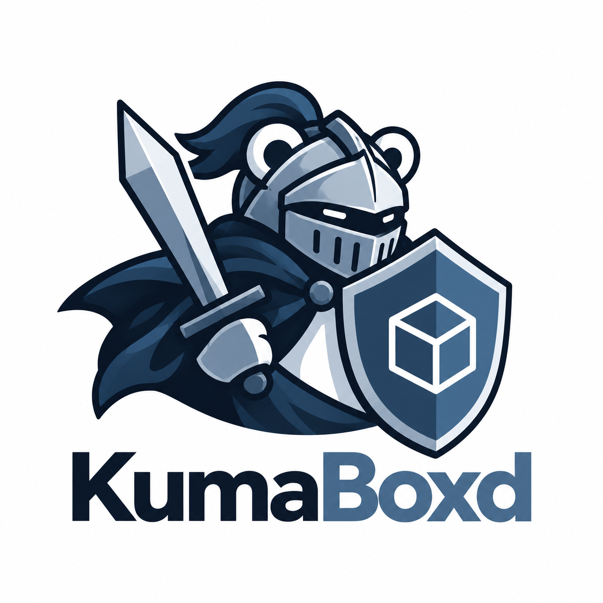
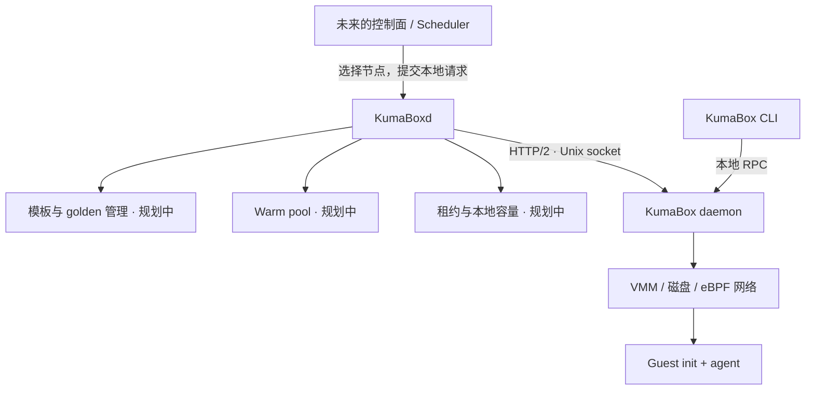

<p align="center">
  
</p>

<h1 align="center">KumaBoxd</h1>
<p align="center">A node agent for KumaBox sandboxes.</p>

KumaBoxd 是构建在 [KumaBox](https://github.com/kgpp34/KumaBox) runtime 之上的节点服务，用于管理本机的沙箱模板、预热池、租约和容量。未来的控制面负责选择节点，KumaBoxd 负责在选中的节点上交付沙箱。

**当前处于工程初始化阶段。** 已实现服务入口、runtime RPC 连接、健康检查和优雅退出。模板、warm pool、claim/release 和持久化租约尚未实现；本项目目前不能交付沙箱，也没有新的性能测试结论。

## 职责与架构



| 层 | 负责什么 |
| --- | --- |
| KumaBox runtime | 镜像、VM 生命周期、磁盘、快照、网络、guest 操作及这些资源的状态一致性 |
| KumaBoxd | 模板、预热库存、租约、本机容量与这些业务对象的恢复，均属于后续实现范围 |
| 未来控制面 | 集群节点发现、全局调度、租户与集群策略 |

KumaBoxd 复用 runtime 的本地 RPC。它不导入 KumaBox 的实现包，不打开 runtime 的 SQLite，也不通过启动 CLI 子进程驱动 VM。两者各自管理自己的进程生命周期；停止 KumaBoxd 不会关闭 runtime 或已有沙箱。

runtime 适配器当前只实现只读的 `node.info`，对齐 KumaBox 提交 `360c562` 所使用的 `/rpc/v1/` 协议。它还不是独立发布的通用 runtime SDK，探测成功也不代表未来所有变更操作均已通过兼容性验证。

## 本地运行

需要 Go 1.24.4 或更高版本。编译与单元测试不需要 KVM、root 或运行中的 VM；真正管理沙箱的 runtime 需要另行部署在 Linux/KVM 节点上。

```bash
make build
./bin/kumaboxd --help
./bin/kumaboxd --runtime-socket /run/kumabox/kumabox.sock
```

另一终端中执行：

```bash
curl -i http://127.0.0.1:8088/healthz
curl -i http://127.0.0.1:8088/readyz
```

| 接口 | 返回与含义 |
| --- | --- |
| `GET /healthz` | `200 {"status":"ok"}`：节点 HTTP 服务存活 |
| `GET /readyz` | `200 {"status":"ready"}`：runtime 的 `node.info` 已成功应答 |
| `GET /readyz` | `503 {"status":"not_ready"}`：runtime 不可达、超时或响应无效 |

没有运行 runtime 时，`/healthz` 仍返回 200，`/readyz` 返回 503。这里的 readiness 只检查 runtime RPC 可用性，不代表有可领取的库存、资源足够或某台 guest 已就绪。

HTTP 当前仅允许绑定 loopback IP，默认 `127.0.0.1:8088`；远程 API 和认证尚未实现。日志输出到 stderr，错误详情不放入健康响应。按 Ctrl+C 或发送 SIGTERM 会取消探测并在有限时间内关闭 HTTP 服务。

### 配置

显式参数优先于环境变量，环境变量优先于默认值。

| 参数 | 环境变量 | 默认值 |
| --- | --- | --- |
| `--listen` | `KUMABOXD_LISTEN` | `127.0.0.1:8088` |
| `--runtime-socket` | `KUMABOXD_RUNTIME_SOCKET` | `/run/kumabox/kumabox.sock` |
| `--probe-timeout` | — | `2s` |
| `--shutdown-timeout` | — | `5s` |
| `--version` | — | 打印构建版本并退出 |

进程需要连接 runtime socket 的权限。连接使用常驻、可复用的 HTTP/2 transport，不按探测重复打开数据库，也不会在连接失败时退回直接操作本地状态。

## 下一阶段：模板与 warm pool

以下是实现边界，不是已上线能力。

```text
准备模板
  固定 image / golden / VM shape / guest 与 VMM 兼容版本
      ↓
后台补池
  runtime clone → guest ready → 完成独立身份初始化 → 标记 Ready
      ↓
Claim
  本地容量校验 → 原子预留 Ready VM → 持久化租约与访问绑定 → 返回
      ↓
Release / TTL 到期
  使租约失效 → 回收访问与 VM → 确认销毁 → 异步补充新的 VM
```

- **模板**：使用不可变的 image/golden 标识，池键包含资源规格与兼容信息，避免不同启动协议的快照混用。
- **Warm pool**：每个池有明确的目标库存和资源预算；补池是后台任务，缺货行为通过 API 明确定义。
- **租约**：claim/release/renew 需要幂等键和持久化状态。第一版销毁用过的 VM，再从 golden 补充，不把用过的 guest 直接交给下一个用户。
- **重启恢复**：KumaBoxd 恢复自己的模板、库存和租约，向 runtime 查询实际资源后收敛；runtime 继续负责 VMM、TAP 和磁盘的底层恢复。
- **性能验证**：分别记录有库存的 claim、无库存的真实 clone、guest 首次执行命令和网络可用时间，不把后台准备成本藏进指标。

先跑通单节点闭环和有网卡的并发验证，再接远程控制面与调度。KumaBoxd 的 Go runtime client 服务于节点内部调用；面向用户的 SDK 仍以 Python、TypeScript 为主要方向。

## 工程结构

```text
cmd/kumaboxd/           参数入口、依赖组装、信号处理
internal/config/       配置读取与校验
internal/node/         节点 HTTP 服务与生命周期
internal/runtimeclient/  KumaBox RPC 适配器
assets/logo.png        项目徽标原图
.github/workflows/     Linux / macOS 检查
```

按实际职责增加包，不为尚未实现的能力建立空接口或空目录。接口由使用方定义；资源释放和超时保持显式。

```bash
make verify
make race
make lint              # golangci-lint v2.13.2
```

测试覆盖真实 Unix socket 上的 HTTP/2 请求格式、连接复用、取消、无效响应，以及节点服务的健康语义和退出流程。这些测试不等同于真实 VM 的端到端验收。当前只使用 Go 标准库，因此没有 `go.sum`。

本地设计草稿和实验报告可放在 `docs/`，该目录被 Git 忽略；需要随代码审阅的当前架构与开发说明放在本 README。

## License

[MIT](LICENSE) · Copyright (c) 2026 YoungLH
